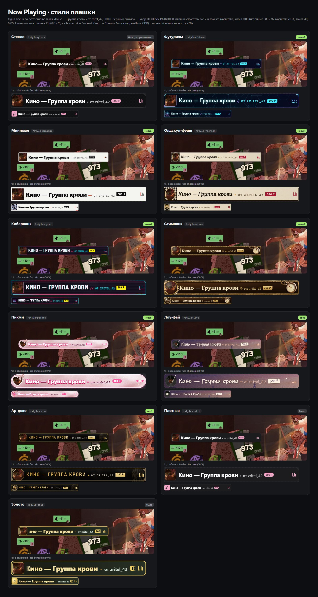
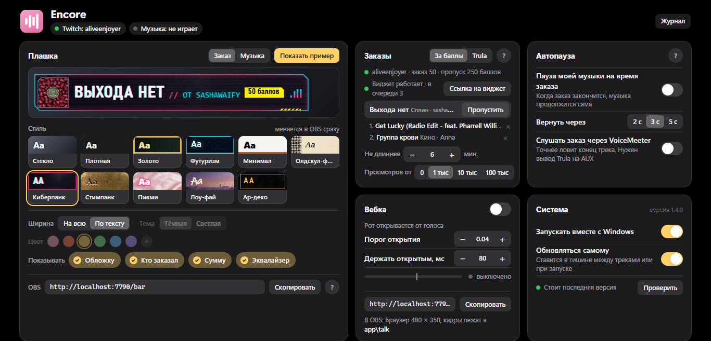

# Encore

Заказ треков за баллы канала Twitch, плашка «что сейчас играет» для OBS и автопауза под заказы. Раньше называлась
Now Playing. Windows 10 и 11, архив меньше 1 МБ, бесплатно.

**[⬇ Скачать Encore.zip](https://github.com/aliveenjoyer/encore/releases/latest/download/Encore.zip)** · [Сайт](https://encore.aliveenjoyer.art) · [Что нового](https://github.com/aliveenjoyer/encore/releases) · [Другие проекты](https://aliveenjoyer.art)

## Что умеет

- Заказ треков за баллы канала, без Trula и без донатов. Encore сама заводит на Twitch две награды: «Заказать трек»
  (50 баллов) и «Пропустить трек» (250). Зритель пишет название или кидает ссылку YouTube, YouTube Music, Spotify или
  SoundCloud, трек играет прямо из Encore через источник в OBS. Названия и цены наград меняются в настройках.
- Лимиты заказов: длина трека, просмотры, сколько треков от одного зрителя, длина очереди, чёрный список слов.
  Баллы спишутся, когда трек заиграет. Не подошёл, убран из очереди или не сыграл, и баллы вернутся сами.
- Показывает трек из YouTube Music, Spotify или любого плеера Windows: название, исполнитель, обложка.
- Играет заказ (за баллы или из Trula): твоя музыка встаёт на паузу и потом играет дальше сама. На плашке заказ, ник
  и сколько зритель отдал.
- 11 стилей плашки: стекло, плотная, золото, футуризм, минимал, олдскул-фэшн, киберпанк, стимпанк, пикми, лоу-фай,
  ар-деко. Стиль меняется в настройках, OBS подхватывает за секунду.
- Обновляется сама: новая версия скачивается отсюда и ставится в тишине между треками или при запуске.
- Бонус: говорящая вебка. Картинка открывает рот, когда ты говоришь.

## Как поставить

1. Скачай [Encore.zip](https://github.com/aliveenjoyer/encore/releases/latest/download/Encore.zip), распакуй папку
   «Encore» целиком и запусти `Encore.exe`. Иконка появится в трее.
2. Если Windows пишет «Система Windows защитила ваш компьютер», нажми «Подробнее» → «Выполнить в любом случае».
   Программа без цифровой подписи, ставить ничего не нужно.
3. Откроются настройки (`http://localhost:7790/`). В карточке «Заказы» нажми «Подключить» и введи код на
   twitch.tv/activate. Заказы идут через Trula? Вставь ссылку на её виджет «Заказ музыки» во вкладке «Trula».
   Выбери стиль плашки.
4. В OBS: Источники → **+** → **Браузер**, ссылка `http://localhost:7790/player`, ширина 720, высота 96, галочка
   «Управление аудио через OBS». В этом источнике и плашка, и звук заказов. Нужна только плашка: `http://localhost:7790/bar`.

Стоит Now Playing 1.3? Она обновится сама и станет Encore, ярлыки и автозапуск переедут. Для заказов за баллы
останется подключить Twitch и поменять в OBS адрес `/bar` на `/player`.

## Обновления

Раз в 6 часов программа смотрит сюда, в релизы. Нашлась новая версия: скачивает её, сверяет контрольную сумму и ставит,
когда пару минут ничего не играет (на стриме это незаметно: плашка в этот момент скрыта), или при следующем запуске.
Плашка в OBS после обновления перезагружается сама. Выключить: настройки → «Система» → «Обновляться самому».
Твои настройки, вход в Twitch, очередь заказов, токен Trula и кадры вебки обновление не трогает.

## Что внутри

Один exe и папка `app`: движок на встроенном в Windows PowerShell, страница настроек и плашка. Без установщика, без
Node и Python, без прав администратора. Всё работает только на твоём компьютере (`localhost`). Twitch: вход по коду
на twitch.tv/activate, Encore просит только права на награды за баллы (`channel:read:redemptions`,
`channel:manage:redemptions`), вход хранится в `app\twitch.json`, зашифрованный средствами Windows. Токен Trula
лежит у тебя в `app\config.json`. Картинки стилей нарисованы для этой программы, шрифты системные с кириллицей.

Сделал [aliveenjoyer](https://github.com/aliveenjoyer). Поддержать: [DonationAlerts](https://www.donationalerts.com/r/aliveenjoyer).
